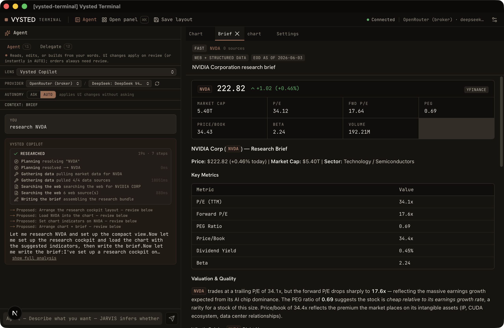

# Vysted Terminal

Vysted Terminal is a desktop app for looking at the markets. It shows prices, charts,
news and company filings in one window, and it has an assistant you can ask in plain words,
such as "How has Reliance Industries done over the past year?" The assistant looks up the
numbers and shows where each one came from. Vysted runs on your own computer. You do not
need an account, and there is no Vysted server that holds your data or your keys.

Vysted is source-available under PolyForm Strict 1.0.0. It is a research tool. It has no
trading of any kind, and nothing it shows is investment advice.

<p align="center">
  
  <br />
  <em>Ask the agent to “research NVDA” — a visual, cited brief lands in the cockpit (metric cards, key-metrics table, written analysis) beside a live research trace.</em>
</p>

---

## Download

Pick the file for your computer. These links always point to the newest release.

- **Mac (Apple Silicon, M1 or newer):**
  [Vysted-Terminal-macOS-AppleSilicon.dmg](https://github.com/techlogist1/vysted-terminal/releases/latest/download/Vysted-Terminal-macOS-AppleSilicon.dmg)
- **Windows (64-bit):**
  [Vysted-Terminal-Windows-x64-Setup.exe](https://github.com/techlogist1/vysted-terminal/releases/latest/download/Vysted-Terminal-Windows-x64-Setup.exe)

<!-- R16-LINUX -->

- **Linux (64-bit, x86_64):**
  [Vysted-Terminal-Linux-x86_64.AppImage](https://github.com/techlogist1/vysted-terminal/releases/latest/download/Vysted-Terminal-Linux-x86_64.AppImage)

<!-- /R16-LINUX -->

Intel Macs are not supported yet.

To check that your download is intact, get
[SHA256SUMS.txt](https://github.com/techlogist1/vysted-terminal/releases/latest/download/SHA256SUMS.txt)
from the same place. It lists the expected checksum for each file. On a Mac, run
`shasum -a 256 <file>` in Terminal. On Windows, run `certutil -hashfile <file> SHA256` in
Command Prompt. The result should match the line for your file.

## Install

Vysted is not code-signed. Apple and Microsoft charge a yearly fee for signing, and Vysted
does not pay it. This means your computer will warn you the first time you open the app. The
warning is expected. Follow the steps for your system once. After that the app opens
normally.

### Mac

1. Open the `.dmg` file. Drag **Vysted Terminal** onto **Applications**. The window itself
   repeats the next steps.
2. Open **Vysted Terminal** from Applications. macOS says it cannot verify the app. Click
   **Done**. Do not move it to the Trash.
3. Open **System Settings**, then **Privacy & Security**. Scroll down to the notice about
   Vysted Terminal and click **Open Anyway**.
4. Confirm. From now on the app opens like any other.

On macOS 15 and later, right-click then Open no longer works for unsigned apps. Use
**Open Anyway** as above.

If macOS says the app is "damaged", the cause is a quarantine flag that macOS puts on
downloaded files. The app is not broken. Open Terminal and run this once, then try again:

```bash
xattr -dr com.apple.quarantine "/Applications/Vysted Terminal.app"
```

### Windows

1. Run `Vysted-Terminal-Windows-x64-Setup.exe`. It installs for your user account only.
2. Windows may show "Windows protected your PC". Click **More info**, then **Run anyway**.
3. Finish the installer and open Vysted Terminal from the Start menu.

<!-- R16-LINUX -->

### Linux

1. Make the file runnable. In a terminal: `chmod +x Vysted-Terminal-Linux-x86_64.AppImage`.
2. Run it: `./Vysted-Terminal-Linux-x86_64.AppImage`.

On Ubuntu 22.04 and newer, AppImages need a small helper package. Install it with
`sudo apt install libfuse2`. On Ubuntu 24.04 the package is called `libfuse2t64`.

<!-- /R16-LINUX -->

The first launch takes a little longer than later ones, because the app unpacks its built-in
data engine. Wait until the status chip shows that it is connected. No Python or other
software needs to be installed first.

## First run

1. **Terms.** A short page explains what Vysted is and is not. Read it and click **I
   understand — continue**.
2. **How should Vysted think?** Prices, charts and news already work without any setup. This
   question is only about the assistant. You have three choices:
   - **On this computer.** Vysted downloads a free model and runs it here. Nothing you ask
     leaves your machine. There is no key and no cost. Answers are slower than from an online
     model.
   - **My own API key.** You paste a key from a provider such as OpenRouter, OpenAI or
     Anthropic. Answers are fastest. The provider charges you for use, usually cents per
     question. The key is stored in your computer's keychain and is sent only to that
     provider.
   - **Skip for now.** Look around first. Charts and data still work without a key. You can
     turn the assistant on later from Settings.
3. **A short tour.** Four cards show the assistant, the chart, the watchlist, and the command
   palette (Cmd+K on a Mac, Ctrl+K on Windows and Linux). The tour ends with an example. If you
   chose a model or a key, it offers "How has Reliance Industries done over the past year?" If
   you skipped, it offers **Show Reliance on the chart**, which opens `RELIANCE.NS` for you.

Every path has a way forward. If something does not work, the app tells you what to do next.
You can change your choice at any time in Settings.

Web research works without a key. A private search engine (SearXNG, which needs Docker) is an
optional extra under **Settings, Advanced**. You never need it.

## Using a model on your computer

Vysted ships with a small program (llama.cpp's `llama-server`, build b11429, MIT licence) that
runs a model on your machine. The models themselves are downloaded when you ask for them, from
the first-run question or from **Settings, Models**. Before a download starts, the page shows
the model's licence. All four choices are Apache-2.0.

| Model              | Download size |
| ------------------ | ------------- |
| IBM Granite 4.2 3B | about 2.1 GB  |
| Qwen 3.5 4B        | about 2.6 GB  |
| IBM Granite 4.2 8B | about 5.0 GB  |
| Qwen 3.5 9B        | about 5.3 GB  |

Vysted checks how much memory your computer has and recommends one model. The Models page
marks each one "Runs well here", "A tight fit" or "Too big for this computer". The
recommendation depends on memory size: under 8 GB, 8 GB, 16 GB, or 32 GB and more.

<!-- R16-MEASURE: per-tier recommendation -->

On a computer with under 8 GB, a model is possible but tight, and an own key is usually the
better choice.

Downloads are built to survive bad connections:

- If your connection drops, or you close and reopen the app, the download resumes where it
  stopped.
- Vysted checks free disk space before the download and again during it.
- When the file is complete, Vysted verifies it against a known checksum before using it. If
  the file is damaged, it is deleted and you are asked to try again.
- If the model engine stops by accident, Vysted restarts it. After three restarts in ten
  minutes it stops trying, tells you so, and offers **Try again**.

If you already use Ollama, the models you have there are detected and can be used too.

Small models can still word things loosely. Vysted checks the figures an answer states against
what the data tools actually returned.

## Updates

Vysted checks for a new version 15 seconds after it starts, and every 6 hours after that. When
one is found it shows the version and what changed. Click **Restart to update** when you are
ready, or **Later**. If a model is still downloading, the button reads **Update after the
download finishes** and waits. Updates are signature-checked with Vysted's own signing key
before they are installed.

## Privacy

- There is no account and no Vysted server.
- Your keys are stored in your computer's keychain. They are sent only to the provider they
  belong to.
- Your notes, watchlist and portfolio stay on your computer.
- Nothing is sent anywhere except the data providers you query and the model provider you
  choose. A model running on your computer sends nothing at all.

---

## What is in the box

Vysted is a Tauri desktop app with three cooperating processes on one machine (loopback only):
a **Rust core** (windowing, OS keychain, sidecar lifecycle), a **Vite + React frontend** (the
panel cockpit), and a **Python FastAPI sidecar** (data and AI compute), plus bundled MCP
subprocesses (OpenBB fundamentals and macro, SEC EDGAR filings) and the llama.cpp engine.

- **A multi-panel cockpit** (dockview): Chart (50 server-computed indicators and drawing
  tools), Watchlist, News (RSS and optional NewsAPI, with sentiment), Portfolio (hand-kept
  holdings with P&L and CSV export), Equity Overview, Macro, SEC Filings, Earnings, Analyst
  Ratings, Screener, Quant (QuantLib), Backtest, and a Node Editor workflow surface.
- **An agentic AI copilot**: a real tool-use loop in the sidecar. The model calls tools to
  pull data and drive the terminal. It ships with first-party agents plus user-authored custom
  agents.
- **Bring-your-own-key** for several providers, or a free model on your own computer.
- **A plugin platform**: one serializable `VystedPlugin` contract (data, panels, commands,
  agents, nodes, control plane).
- **MCP on both sides**: Vysted proxies bundled MCP data servers and re-exposes its own
  capabilities as MCP tools for external agents.

Vysted has no brokerage connection. It cannot place, stage or simulate an order. See
[`docs/CURRENT_STATE.md`](./docs/CURRENT_STATE.md) for what works, what is buggy and what is
deferred, and [`docs/RELEASE_NOTES_v0.10.0.md`](./docs/RELEASE_NOTES_v0.10.0.md) for this
release.

---

## Prerequisites

| Dependency              | Required version | Notes                                       |
| ----------------------- | ---------------- | ------------------------------------------- |
| Node.js                 | 24+              | LTS or Current                              |
| pnpm                    | 10+              | `npm i -g pnpm`                             |
| Rust (stable toolchain) | latest stable    | `rustup toolchain install stable`           |
| C/C++ build tools       | —                | VS Build Tools 2022 on Windows              |
| Python                  | 3.13+            | Used by the FastAPI sidecar and PyInstaller |

**Windows:** Install [Visual Studio Build Tools 2022](https://visualstudio.microsoft.com/visual-cpp-build-tools/)
with the "Desktop development with C++" workload. WebView2 Runtime must also be present
(ships with Windows 11; downloadable separately for Windows 10).

---

## Local Development

```bash
git clone https://github.com/techlogist1/vysted-terminal.git
cd vysted-terminal
pnpm install
pnpm tauri dev
```

The first `pnpm tauri dev` builds the Python sidecar binaries via PyInstaller before
launching (a one-time ~1–2 minute step; subsequent runs skip it unless sidecar source
changes). Before any release tag, run the CI-parity gate and the binary smoke-test:

```bash
pnpm ci-local                       # lint + format + typecheck + clippy + ruff + tests
node scripts/smoke-test-sidecars.mjs # spawn each sidecar binary, probe /health + MCP bind
```

---

## Project Layout

| Path         | Contents                                                                    |
| ------------ | --------------------------------------------------------------------------- |
| `src/`       | Vite + React 19 frontend (TypeScript, Tailwind 4, shadcn/ui)                |
| `src-tauri/` | Rust Tauri 2.x core — windowing, keychain, sidecar lifecycle, IPC           |
| `sidecar/`   | Python 3.13 FastAPI sidecar (+ MCP subprocesses), bundled by PyInstaller    |
| `types/`     | Shared TypeScript types; `plugin.ts` is the canonical plugin contract       |
| `plugins/`   | Bundled plugins (example, openbb-mcp, yfinance, vysted-news, vysted-lenses) |
| `styles/`    | Design tokens (`tokens.css`) — Tailwind 4 `@theme` variables                |
| `docs/`      | Architecture docs — start at [`docs/README.md`](./docs/README.md)           |

---

## Contributing

See [CONTRIBUTING.md](./CONTRIBUTING.md).

## License

Vysted Terminal is source-available. It is free for noncommercial use under
[PolyForm Strict 1.0.0](./LICENSE). Commercial use, modification, or redistribution
requires a paid license — see [`COMMERCIAL_LICENSE.md`](./COMMERCIAL_LICENSE.md) and
[`LICENSING.md`](./LICENSING.md) for the plain-language summary. Every commit before the
relicensing commit remains available under its original AGPL-3.0 terms. The plugin
contract and example plugin are separately licensed under
[Apache-2.0](./LICENSE-APACHE).

## Status

**Version 0.10.0 ("Easy Install").** One-file installers for macOS, Windows and Linux, free
models that run on your own computer, a first-run setup, and a built-in updater. See
[`docs/RELEASE_NOTES_v0.10.0.md`](./docs/RELEASE_NOTES_v0.10.0.md). Status for the
agent-native redesign — build phase, what's shipped vs still in flight — is
tracked live in [`docs/CURRENT_STATE.md`](./docs/CURRENT_STATE.md), the
current-state baseline; the original plan is
[`docs/BLUEPRINT.md`](./docs/BLUEPRINT.md).
